# ChibaKanji 🇯🇵

Ứng dụng Flutter học và ôn tập từ vựng tiếng Nhật **JLPT N5** và **từ vựng chuyên ngành cho thực tập sinh**. Người học đi theo những phiên ngắn mỗi ngày: học từ mới bằng flashcard, ôn lại đúng lúc nhờ thuật toán ôn tập ngắt quãng, kiểm tra bằng quiz và thi thử có giờ. Dữ liệu lưu trên Firebase nên đổi máy vẫn giữ tiến độ.

Giao diện theo phong cách Nhật Bản: nền giấy washi, họa tiết sóng seigaiha, cành hoa anh đào, núi Phú Sĩ, cổng torii và linh vật **Chibi**.

## Giao diện

<table>
  <tr>
    <td align="center"><br><sub>Màn khởi động</sub></td>
    <td align="center">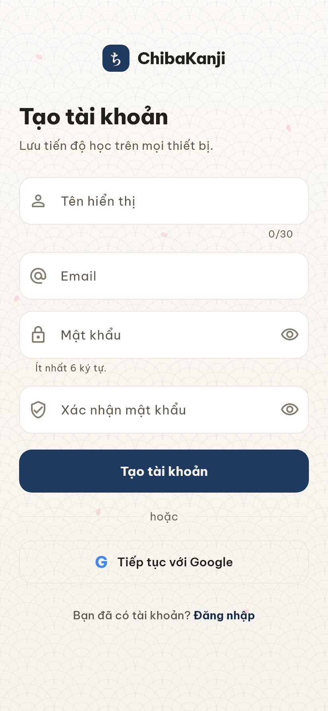<br><sub>Đăng ký</sub></td>
    <td align="center">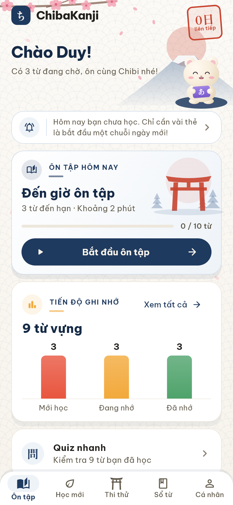<br><sub>Trang chủ (Ôn tập)</sub></td>
    <td align="center">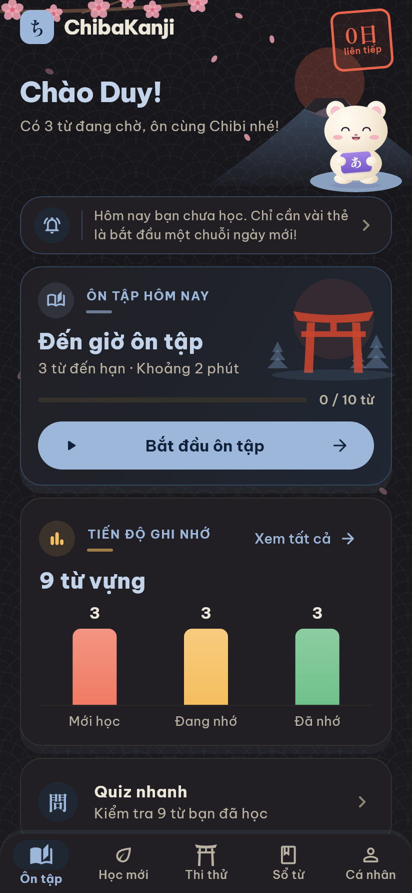<br><sub>Giao diện tối</sub></td>
  </tr>
  <tr>
    <td align="center">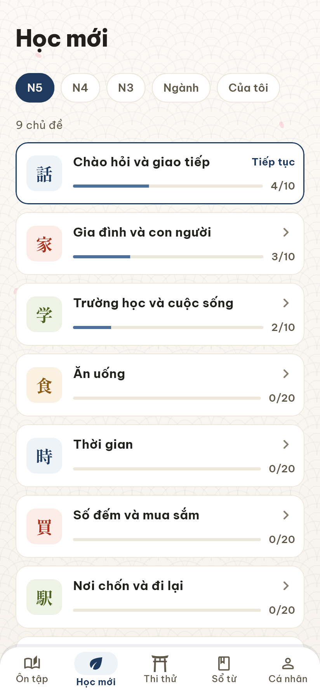<br><sub>Học mới: chủ đề</sub></td>
    <td align="center">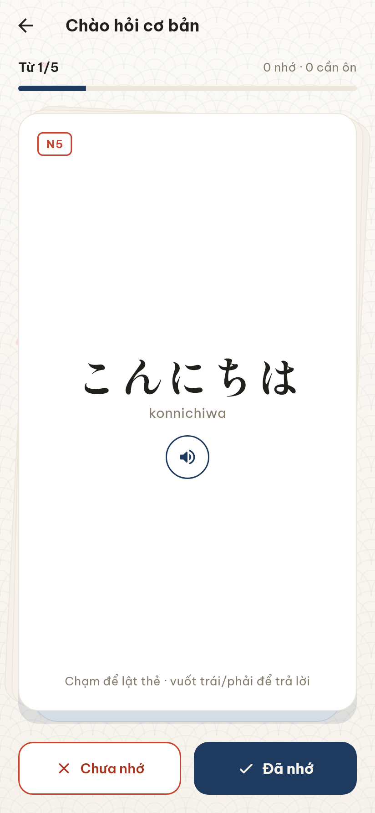<br><sub>Flashcard</sub></td>
    <td align="center">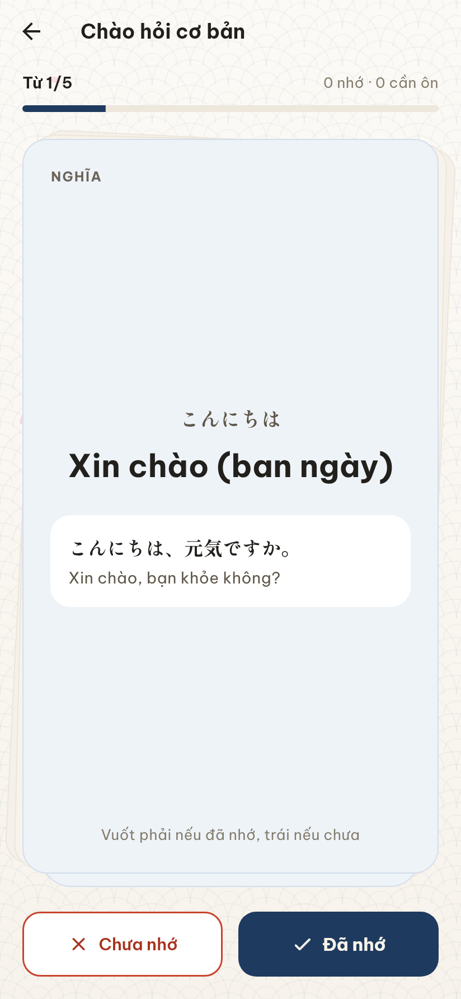<br><sub>Mặt sau thẻ</sub></td>
    <td align="center">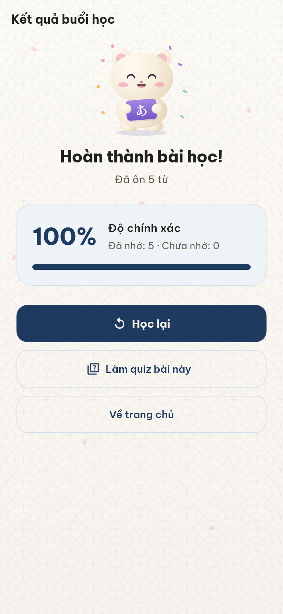<br><sub>Kết quả phiên học</sub></td>
  </tr>
  <tr>
    <td align="center">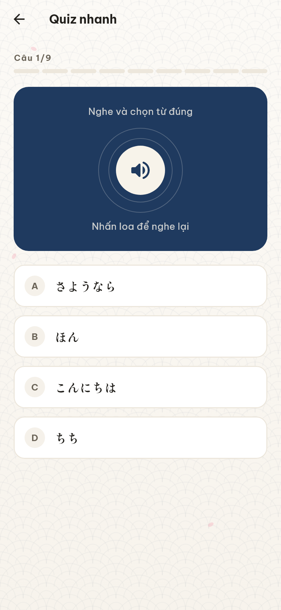<br><sub>Quiz</sub></td>
    <td align="center">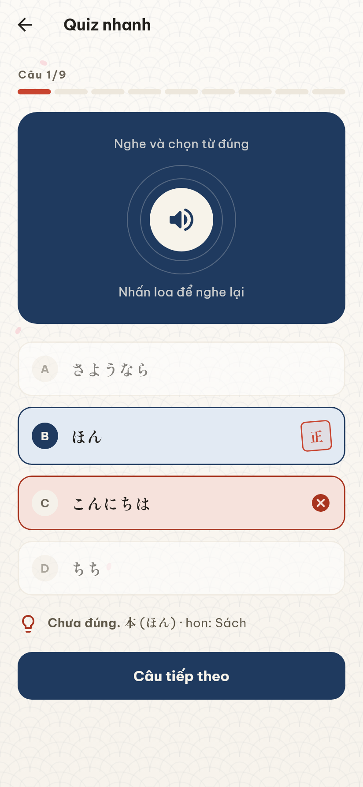<br><sub>Giải thích đáp án</sub></td>
    <td align="center">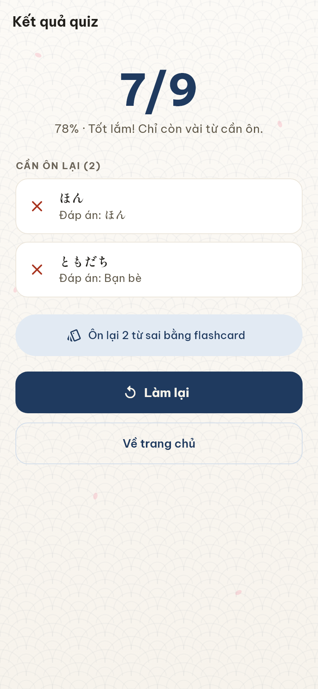<br><sub>Kết quả quiz</sub></td>
    <td align="center">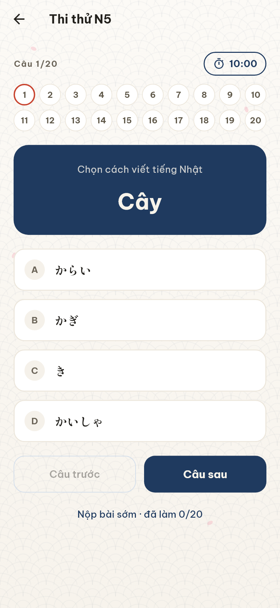<br><sub>Thi thử có giờ</sub></td>
  </tr>
  <tr>
    <td align="center">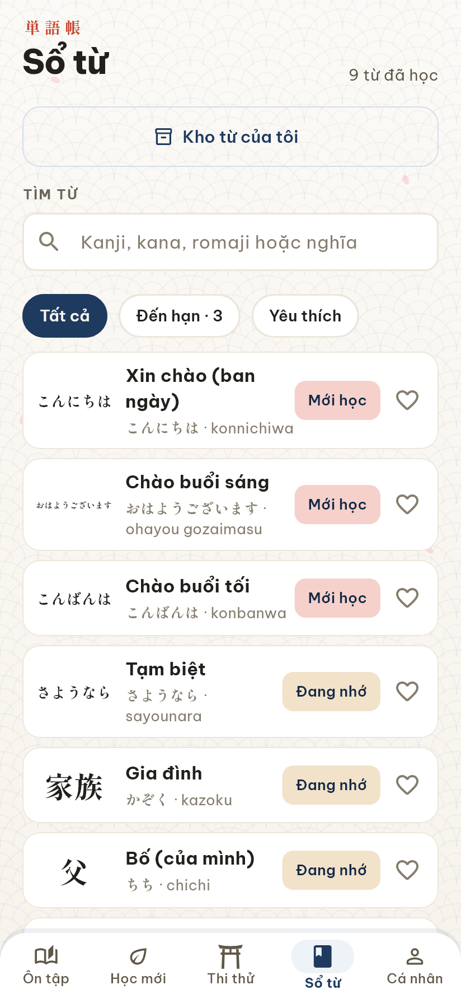<br><sub>Sổ từ</sub></td>
    <td align="center">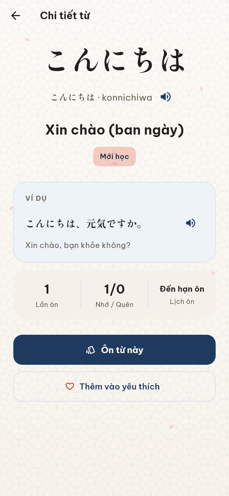<br><sub>Chi tiết từ</sub></td>
    <td align="center">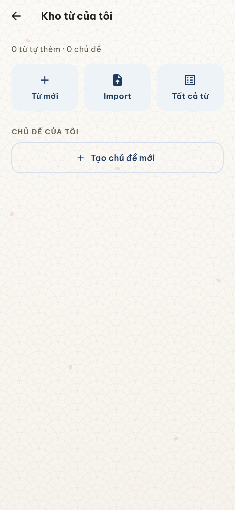<br><sub>Kho từ của tôi</sub></td>
    <td align="center">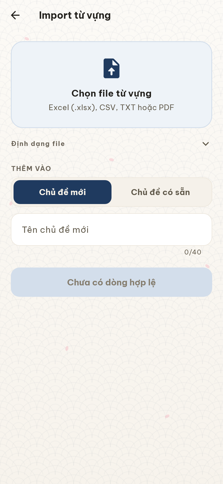<br><sub>Import Excel, CSV, PDF</sub></td>
  </tr>
  <tr>
    <td align="center">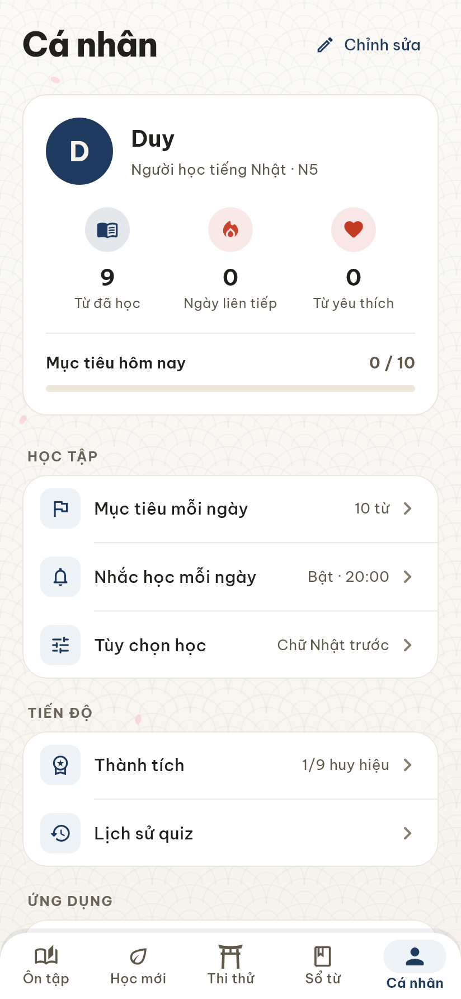<br><sub>Cá nhân</sub></td>
    <td align="center">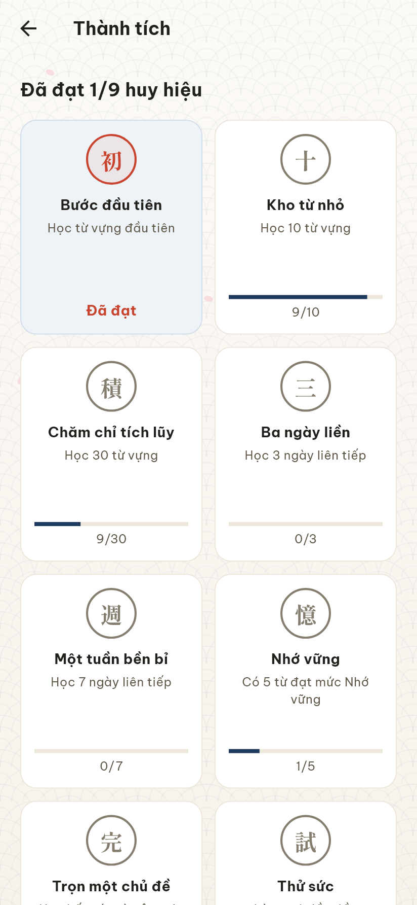<br><sub>Thành tích</sub></td>
    <td align="center">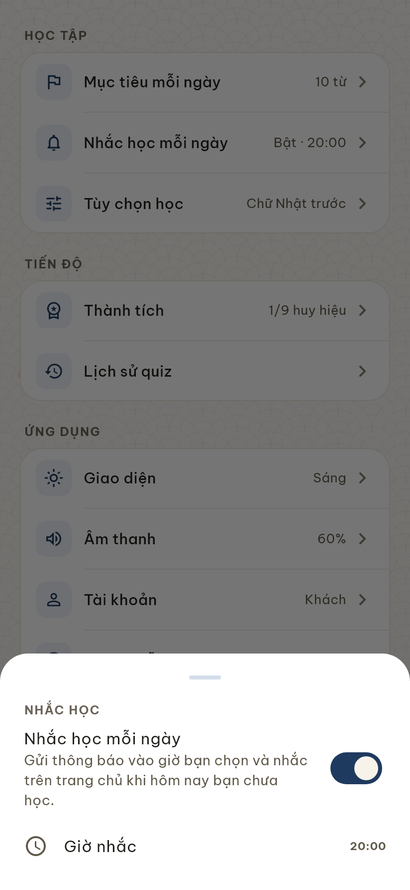<br><sub>Nhắc học theo giờ</sub></td>
    <td align="center">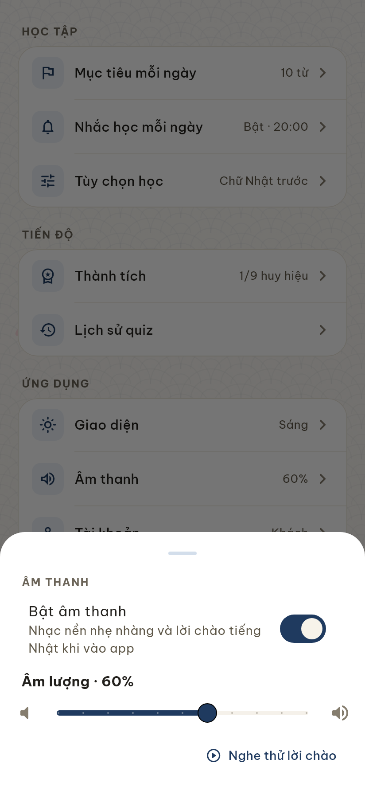<br><sub>Âm thanh</sub></td>
  </tr>
</table>

Toàn bộ 29 màn hình nằm trong [`docs/screenshots`](docs/screenshots).

## Chức năng

Ứng dụng có 5 tab trên thanh điều hướng:

| Tab | Chức năng |
|---|---|
| **Ôn tập** | Lời chào theo giờ, số từ đến hạn ôn, mục tiêu hôm nay, chuỗi ngày học (dấu triện 日), biểu đồ tiến độ ghi nhớ, Quiz nhanh |
| **Học mới** | Chọn cấp độ (N5, N4, N3, Ngành, Của tôi; N4 và N3 đang bổ sung nội dung), chủ đề, bài học rồi học bằng flashcard |
| **Thi thử** | Chọn phạm vi (cấp độ, chủ đề, từ đã học), số câu; làm bài có đồng hồ, nộp bài mới chấm, đóng dấu 合格 / 不合格 |
| **Sổ từ** | Tìm, lọc (tất cả, đến hạn, yêu thích), xem chi tiết từ, nghe phát âm; vào **Kho từ của tôi** |
| **Cá nhân** | Hồ sơ, mục tiêu, nhắc học, tùy chọn học, thành tích, lịch sử quiz, giao diện sáng/tối, âm thanh, tài khoản |

### Học và ôn tập

- **Flashcard:** lật thẻ, vuốt phải (Đã nhớ) hoặc trái (Chưa nhớ), nghe phát âm, xem kết quả phiên học.
- **Ôn tập ngắt quãng:** 5 mức ghi nhớ; đúng thì lên một mức, sai thì về mức 1; lần ôn tiếp theo sau 1, 3, 7, 14, 30 ngày tùy mức.
- **Quiz:** 4 dạng câu hỏi (kana → nghĩa, nghĩa → kana, kanji → nghĩa, nghe → từ), giải thích đáp án, lưu lịch sử; ôn lại ngay các từ sai bằng flashcard.
- **Thi thử:** đề trắc nghiệm có giới hạn thời gian như JLPT; hết giờ tự nộp, đạt từ 60%.
- **Kho từ của tôi:** tự tạo chủ đề, thêm từ, import từ file Excel (.xlsx), CSV, TXT hoặc PDF; import xong học ngay bằng flashcard.

### Tài khoản và cá nhân hóa

- **Tài khoản:** dùng thử ngay bằng tài khoản khách; đăng ký/đăng nhập bằng email hoặc Google mà không mất tiến độ đã học; đổi mật khẩu; xóa tài khoản kèm toàn bộ dữ liệu.
- **Nhắc học:** thông báo mỗi ngày vào giờ tự chọn (Android/iOS) và lời nhắc trên trang chủ khi hôm nay chưa học.
- **Âm thanh:** lời giới thiệu ở màn khởi động, lời chào tiếng Nhật theo buổi (おはようございます / こんにちは / こんばんは), nhạc nền chuông gió; bật/tắt và chỉnh âm lượng.
- **Giao diện:** sáng (mặc định) và tối.
- **Nội dung:** 150 từ N5 (9 chủ đề) và 60 từ chuyên ngành (Chế biến thực phẩm, Xây dựng, Điều dưỡng).

## Kiến trúc

```text
Màn hình (lib/screens)  ──watch/read──▶  Provider (lib/providers)  ──▶  Repository (lib/repositories)  ──▶  Cloud Firestore
                                               │                                ▲
                                               └── Dịch vụ (lib/services):     └── Model + ORM toMap/fromMap (lib/models)
                                                   giọng đọc, nhạc nền, thông báo
```

- **Màn hình** chỉ hiển thị và nhận thao tác; quy tắc nghiệp vụ nằm trong **Provider** (`ChangeNotifier`).
- **Repository tổng quát** `Repository<T, ID>` có bản Firestore, bản bộ nhớ (dùng cho test) và bản gộp từ chung với từ tự thêm.
- Provider chỉ biết interface (repository, đăng nhập, giọng đọc, nhạc nền, thông báo) nên khi kiểm thử được thay bằng bản giả, không cần mạng.

Sơ đồ lớp (Class Diagram), sơ đồ tuần tự (Sequence) và sơ đồ hoạt động (Activity) vẽ từ mã nguồn: xem [docs/so-do-thiet-ke.md](docs/so-do-thiet-ke.md).

### Kiến thức môn học được áp dụng

| Nội dung | Ở đâu trong code |
|---|---|
| Lập trình hướng đối tượng | Kế thừa `GenericEntity<ID>` → `LearningContent` → `Category`, `Lesson`, `Vocabulary`; lớp trừu tượng `AuthService`, `Repository` |
| BottomNavigationBar | [`main_screen.dart`](lib/screens/main_screen.dart): 5 tab |
| Form và kiểm tra dữ liệu | [`auth_screen.dart`](lib/screens/auth/auth_screen.dart), [`account_screen.dart`](lib/screens/profile/account_screen.dart): `Form`, `TextFormField`, `validator`; tìm kiếm Sổ từ dùng `onChanged` |
| ListView, GridView, Card, InkWell | Danh sách chủ đề, bài học, Sổ từ; lưới câu hỏi bài thi và lưới huy hiệu Thành tích |
| Generics | `Repository<T, ID>`, `FirestoreRepository<T>`, `CombinedRepository<T>`, `GenericListScreen<T>`, `ChoiceSegments<T>`, `PillChoices<T>` |
| Firebase | Authentication (khách, email, Google), Cloud Firestore, Security Rules ([`firestore.rules`](firestore.rules)) |
| showModalBottomSheet | Tạo chủ đề, chọn mục tiêu, giao diện, nhắc học, âm thanh, xác nhận thoát quiz/nộp bài |

## Công nghệ

- Flutter 3.47 / Dart 3, Material Design; font Be Vietnam Pro và Shippori Mincho (chữ Nhật)
- Provider (quản lý trạng thái)
- Firebase Authentication, Cloud Firestore
- `flutter_tts` (phát âm), `audioplayers` (nhạc nền), `flutter_local_notifications` (nhắc học), `shared_preferences` (cài đặt trên thiết bị), `file_picker` + `excel` + `syncfusion_flutter_pdf` (import từ vựng)
- Flutter Test: **354 test**, độ phủ code **86%**; GitHub Actions chạy format, analyze và test mỗi lần push

## Cấu trúc thư mục

| Thư mục | Nội dung |
|---|---|
| [`lib/models`](lib/models) | Model và ORM `toMap` / `fromMap` |
| [`lib/repositories`](lib/repositories) | Truy cập dữ liệu: Firestore, bộ nhớ (test), kho gộp |
| [`lib/providers`](lib/providers) | Trạng thái và quy tắc nghiệp vụ |
| [`lib/screens`](lib/screens) | Màn hình, chia theo chức năng |
| [`lib/widgets`](lib/widgets) | Widget dùng chung (thẻ, biểu đồ, tranh phong cảnh Nhật, Chibi…) |
| [`lib/auth`](lib/auth) | Đăng nhập: khách, email, Google |
| [`lib/services`](lib/services) | Giọng đọc, nhạc nền, thông báo nhắc học |
| [`lib/data`](lib/data) | Dữ liệu mẫu, bộ tạo câu hỏi, đọc file import, nạp dữ liệu |
| [`test`](test) | Unit test và widget test ([danh sách](test/README.md)) |
| [`docs`](docs) | Sơ đồ thiết kế và ảnh màn hình |
| [`tool`](tool) | Công cụ: tạo nhạc nền, file Excel mẫu, xuất sơ đồ, chụp màn hình, dựng file Word |

## Chạy dự án

```bash
git clone https://github.com/Pham-Duyy/Nhom_App_LearnJPVocab.git
cd Nhom_App_LearnJPVocab
flutter pub get
flutter run -d web-server --web-port 5555
```

Mở **http://localhost:5555** bằng Edge hoặc Chrome. Nên giữ đúng cổng 5555: trình duyệt lưu phiên đăng nhập theo địa chỉ, đổi cổng thì app tạo một tài khoản khách mới.

Chạy trên Android cần Android Studio (có sẵn Java) và bật **Developer Mode** của Windows để Flutter build được các plugin:

```bash
flutter run -d <mã thiết bị>
```

## Kiểm thử

```bash
dart format lib test
flutter analyze
flutter test
```

Danh sách test theo từng user story và bảng ca thành công/thất bại: [test/README.md](test/README.md).

## Tài liệu báo cáo

```bash
bash tool/render_diagrams.sh                                          # xuất sơ đồ ra PNG/SVG
flutter test tool/screenshots/screenshots_test.dart --update-goldens  # chụp lại toàn bộ màn hình
dart run tool/make_report_docx.dart                                   # gom sơ đồ và ảnh thành file Word
```

File Word được tạo trong `docs/` và không đưa lên GitHub.

## Nạp nội dung lên Firestore

Nội dung học (`categories`, `lessons`, `vocabularies`) chỉ đọc được từ app; [`firestore.rules`](firestore.rules) chặn mọi thao tác ghi để người dùng không sửa được bài học. Dữ liệu cá nhân nằm dưới `users/{uid}` và chỉ chính chủ đọc/ghi được. Khi thêm nội dung mới vào [`mock_learning_data.dart`](lib/data/mock/mock_learning_data.dart):

1. Trên Firebase Console, tạm đổi `allow write: if false;` thành `allow write: if request.auth != null;` cho 3 collection nội dung.
2. Chạy app một lần với cờ nạp dữ liệu; app chỉ thêm những document còn thiếu:
   ```bash
   flutter run -d edge --dart-define=SEED_CONTENT=true
   ```
3. Đổi Rules về lại `allow write: if false;`.

Chạy bình thường (không có cờ) thì app không ghi gì vào nội dung học.

## Phân công nhóm

| Thành viên | MSSV | Công việc |
|---|---|---|
| Phạm Khương Duy | 23010743 | Kiến trúc dữ liệu, Provider, Firebase, học, quiz, thi thử, kho từ, giao diện, âm thanh, kiểm thử |
| Nguyễn Vũ Trường Sơn |24100468 | Hỗ trợ phát triển, flashcard lật thẻ, tài liệu báo cáo |

> Nhóm điền mã số sinh viên và phần đóng góp chi tiết của từng thành viên trước khi nộp bài.

## Trạng thái

- [x] Bottom Navigation Bar 5 tab, giao diện phong cách Nhật, sáng/tối
- [x] Ôn tập ngắt quãng, Học mới, Flashcard, Sổ từ, Cá nhân
- [x] Firebase Authentication (khách, email, Google) và Cloud Firestore
- [x] Quiz, kết quả, lịch sử và ôn lại từ sai
- [x] Thi thử có giờ
- [x] Phát âm, lời chào tiếng Nhật, nhạc nền
- [x] Kho từ của tôi và import từ vựng
- [x] Từ vựng chuyên ngành
- [x] Thông báo nhắc học theo giờ (Android/iOS; web chỉ nhắc trên trang chủ)
- [x] Đổi mật khẩu, xóa tài khoản và dữ liệu
- [x] CI chạy format, analyze và test
- [ ] Nội dung N4, N3

---

