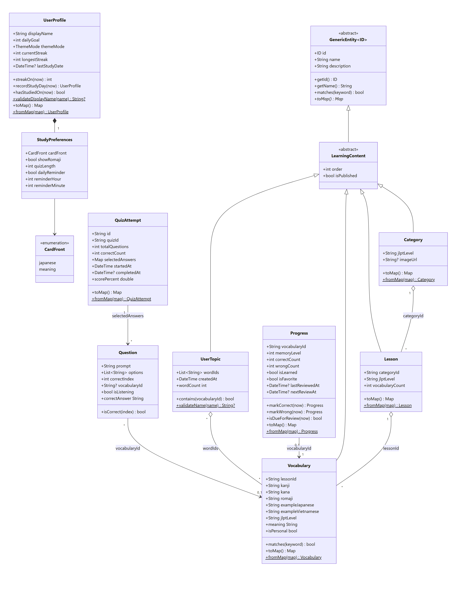
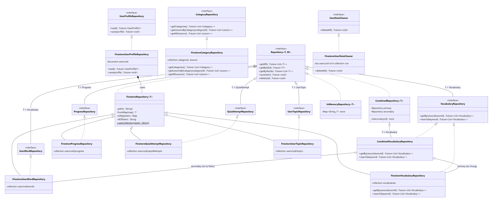
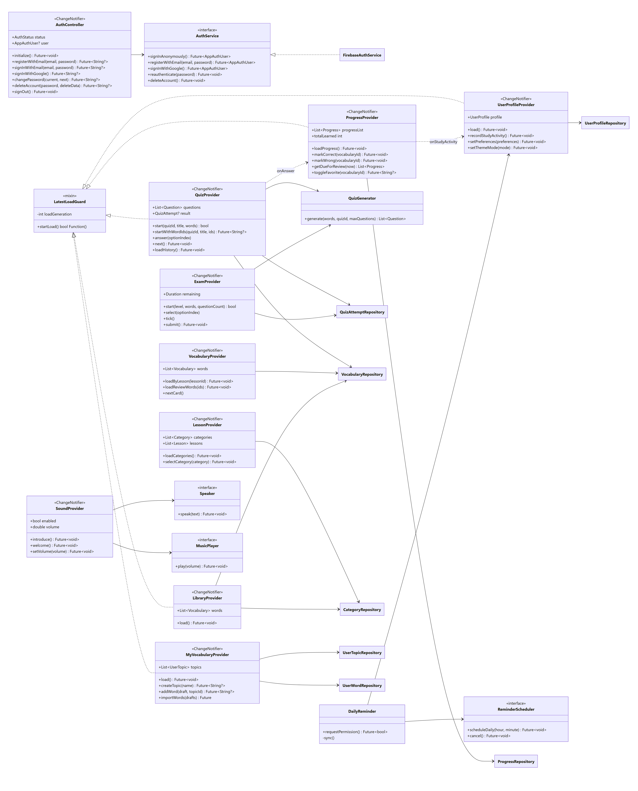
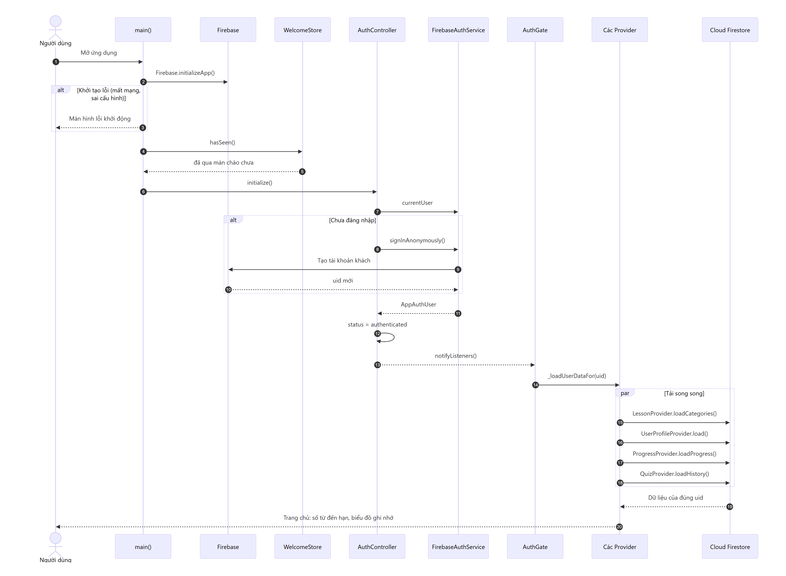
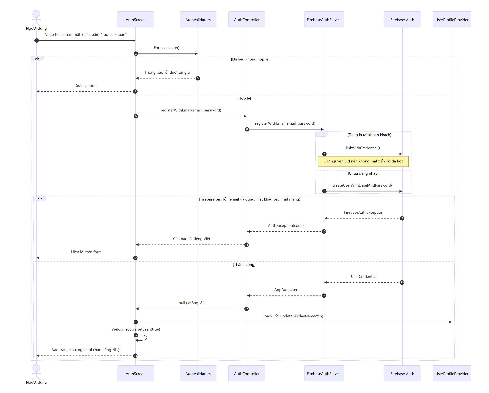
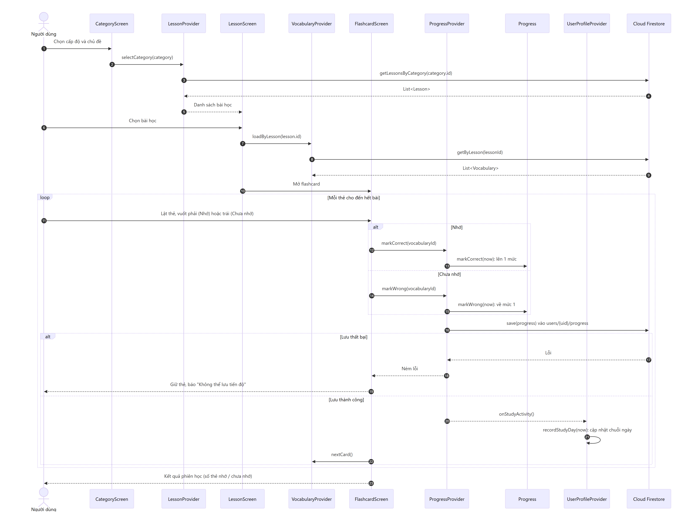
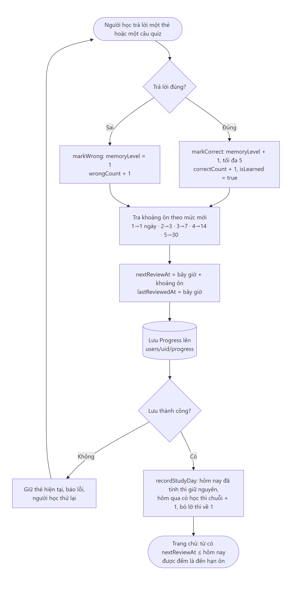
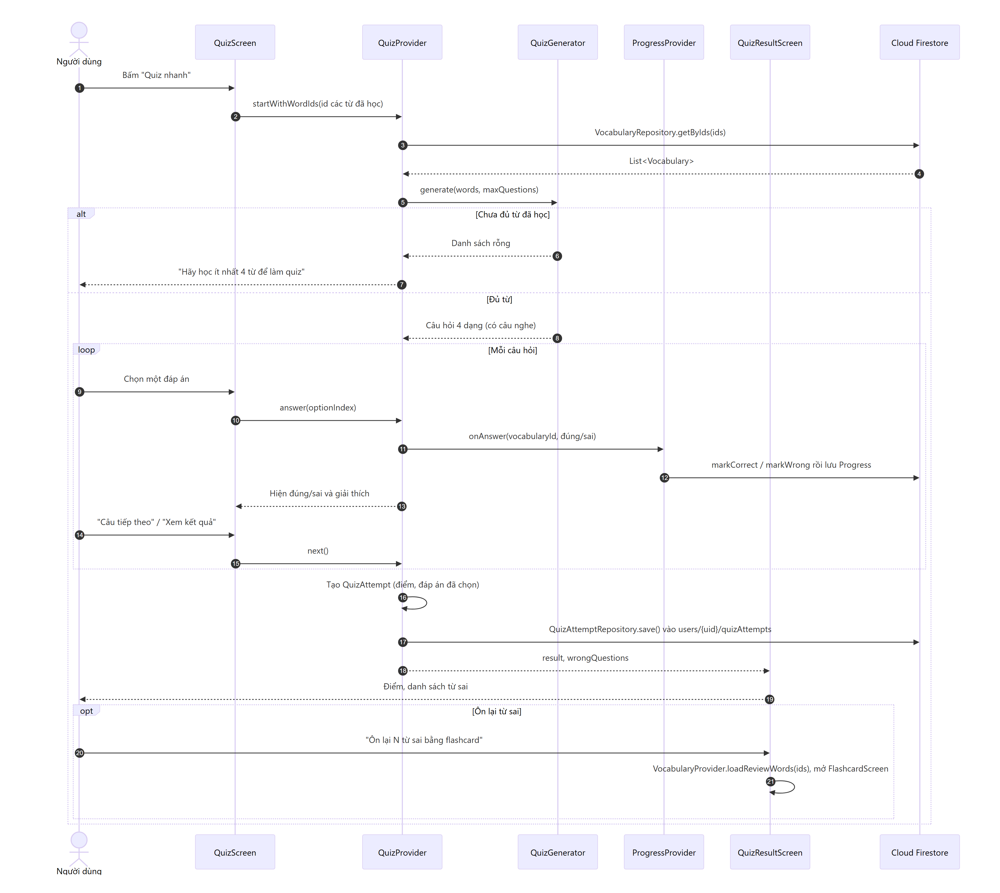
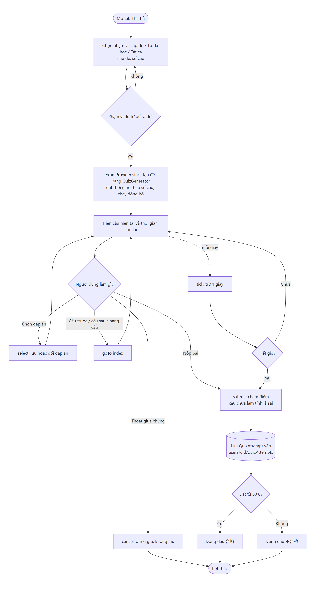

# Sơ đồ thiết kế ChibaKanji

Các sơ đồ dưới đây được vẽ từ mã nguồn hiện tại (tên lớp, thuộc tính, phương thức và thứ tự gọi hàm đều lấy từ code). Mã nguồn Mermaid nằm trong [`docs/diagrams`](diagrams), ảnh PNG/SVG để chèn báo cáo nằm trong [`docs/diagrams/png`](diagrams/png).

Sửa một file `.mmd` rồi chạy lại lệnh sau (Git Bash, thư mục gốc dự án) để xuất lại ảnh:

```bash
bash tool/render_diagrams.sh
```

| # | Sơ đồ | Loại |
|---|---|---|
| 1 | Lớp dữ liệu (model) và ORM | Class Diagram |
| 2 | Tầng truy cập dữ liệu (Repository) | Class Diagram |
| 3 | Tầng trạng thái và dịch vụ (Provider) | Class Diagram |
| 4 | Khởi động ứng dụng và đăng nhập khách | Sequence |
| 5 | Đăng ký bằng email | Sequence |
| 6 | Chọn bài và học flashcard | Sequence |
| 7 | Thuật toán ôn tập ngắt quãng | Activity |
| 8 | Làm quiz và lưu kết quả | Sequence |
| 9 | Thi thử có giờ | Activity |

## 1. Lớp dữ liệu (model) và ORM



- `GenericEntity<ID>` là lớp trừu tượng tổng quát (Generics) cho mọi nội dung có `id`, `name`, `description`; `LearningContent` thêm thứ tự hiển thị.
- `Category` → `Lesson` → `Vocabulary`: một chủ đề có nhiều bài, một bài có nhiều từ (liên kết qua `categoryId`, `lessonId`).
- `Progress` lưu mức ghi nhớ của người học với một từ; `markCorrect`/`markWrong` trả về object mới (không sửa trực tiếp).
- `UserProfile` chứa `StudyPreferences` (quan hệ hợp thành); `UserTopic` gom nhiều từ người học tự thêm.
- Mọi model có `toMap()` / `fromMap()`: ánh xạ Object ↔ Document của Firestore (ORM).

## 2. Tầng truy cập dữ liệu (Repository)



- `Repository<T, ID>` là interface tổng quát với 5 thao tác CRUD; mỗi loại dữ liệu có interface riêng kế thừa nó.
- `FirestoreRepository<T>` viết thao tác Firestore một lần cho mọi kiểu `T`; lớp con chỉ khai báo đường dẫn collection và hàm chuyển đổi.
- `InMemoryRepository<T>` là bản lưu trong bộ nhớ dùng cho test, nên test không cần mạng.
- `CombinedVocabularyRepository` gộp từ vựng chung (`vocabularies`) với từ người học tự thêm (`users/{uid}/words`).

## 3. Tầng trạng thái và dịch vụ (Provider)



- Các Provider kế thừa `ChangeNotifier`; màn hình lắng nghe bằng `context.watch` và tự vẽ lại khi dữ liệu đổi.
- Provider chỉ phụ thuộc vào interface (`AuthService`, các Repository, `Speaker`, `MusicPlayer`, `ReminderScheduler`), nên khi test thay bằng bản giả.
- Mixin `LatestLoadGuard` bảo đảm chỉ nhận kết quả của lần tải mới nhất, tránh lẫn dữ liệu khi đổi tài khoản nhanh.
- `QuizProvider` báo kết quả từng câu sang `ProgressProvider` (`onAnswer`), `ProgressProvider` báo sang `UserProfileProvider` để tính chuỗi ngày (`onStudyActivity`).

## 4. Khởi động ứng dụng và đăng nhập khách



Người dùng mới không phải đăng ký ngay: app tự đăng nhập ẩn danh, sau đó `AuthGate` tải song song nội dung học và dữ liệu riêng của đúng `uid`.

## 5. Đăng ký bằng email



Form kiểm tra dữ liệu trước khi gọi Firebase. Nếu đang là tài khoản khách, email được gắn vào chính tài khoản đó (`linkWithCredential`) nên giữ nguyên `uid` và tiến độ đã học. Lỗi của Firebase được đổi thành câu tiếng Việt.

## 6. Chọn bài và học flashcard



Mỗi lần vuốt thẻ, tiến độ được lưu ngay lên Firestore. Nếu lưu thất bại, thẻ được giữ lại để người học thử lại, không mất câu trả lời.

## 7. Thuật toán ôn tập ngắt quãng



Trả lời đúng thì lên một mức (tối đa 5), sai thì về mức 1. Khoảng cách tới lần ôn tiếp theo tăng theo mức: 1, 3, 7, 14, 30 ngày. Quy tắc áp dụng cho cả flashcard và quiz.

## 8. Làm quiz và lưu kết quả



`QuizGenerator` tạo câu hỏi 4 dạng từ các từ đã học. Mỗi câu trả lời cập nhật tiến độ của từ; hết quiz thì lượt làm (`QuizAttempt`) được lưu vào lịch sử. Màn kết quả cho ôn lại ngay các từ sai bằng flashcard.

## 9. Thi thử có giờ



Đồng hồ trừ mỗi giây; hết giờ thì tự nộp bài. Câu chưa làm tính là sai, đạt từ 60% trở lên thì đóng dấu 合格 (đỗ). Thoát giữa chừng thì không chấm và không lưu.
